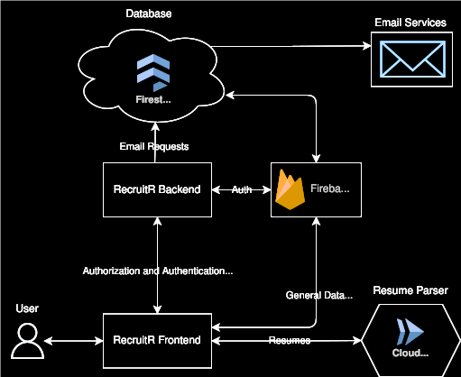

# RecruitR

RecruitR is a web application for managing intern intake. It was used by recruiters to collect candidate information at recruiting events, review resumes, and keep feedback in one place.

Candidates can register from an event QR code and complete their profiles on a phone. Recruiters can then search the candidate list, record feedback, and follow candidates through the intake process.



*The project's architecture: the web application, Firebase services, and the separate resume parser.*

## Motivation

A short conversation at a career fair can leave a recruiter with a resume, a few notes, and details that need to be entered somewhere else later. Those records become harder to manage when several recruiters are meeting candidates at the same event.

We built RecruitR to connect those steps. Candidates enter their own information, events provide the context, and recruiters can review and add feedback while the conversation is still fresh. The goal was to make intern intake easier to manage for both sides.

## The recruiting workflow

1. **Create an event.** A recruiter creates an event and prints its QR code. The code links to sign-up with the event attached.
2. **Collect candidate information.** Candidates create an account, enter their academic information, and upload a PDF resume. Optional resume parsing can fill parts of the profile.
3. **Review candidates.** Recruiters search by name, filter by university or year, sort the table, and open a candidate's profile and resume.
4. **Record feedback.** Recruiters add ratings, notes, technical skills, possible placements, and intake status. Feedback saves as it changes, and the candidate list receives live updates.
5. **Share and manage the intake.** Recruiters can export candidate records to a spreadsheet. Coordinators manage the list of people allowed to register as recruiters.

Candidate, recruiter, and coordinator roles determine which pages and actions are available. The application includes sign-up, login, and password-reset flows.

## How it works

RecruitR uses Next.js and TypeScript for the interface and server routes. Tailwind CSS and shadcn/ui provide the interface components.

Firebase supplies authentication, Firestore records, and resume storage. The main collections are:

| Collection | Contents |
| --- | --- |
| `users` | Candidate profiles, recruiter accounts, and candidate feedback |
| `events` | Recruiting event details |
| `whitelist` | Recruiter and coordinator access |
| `mail` | Outgoing email requests for the Firebase email extension |

Client-side Firestore access supports live updates. Server routes handle work such as role validation, invitations, and email requests. [Firestore rules](firestore.rules) and [middleware](middleware.ts) are part of the access-control implementation.

Resume parsing runs in a separate [Flask service](https://github.com/Recruit-R/recruitr-resume-parser). The web application sends the PDF to that service and uses the response to fill supported profile fields. Resume upload is also available without selecting autofill.

Useful places to start in the source are the [candidate profile](app/candidate/profile), [recruiter dashboard](app/recruit/home), [event management](app/recruit/events), and [recruiter access management](app/recruit/manage-recruiters).

## Running locally

Local development uses a Firebase project for authentication, candidate records, and resume storage.

### 1. Install the application

Use Node.js 20 and npm. Next.js 14 requires Node.js 18.17 or newer.

```sh
git clone https://github.com/Recruit-R/RecruitR.git
cd RecruitR
npm ci
cp .env.example .env.local
```

### 2. Configure Firebase

Create a Firebase project with Authentication, Firestore, and Storage. Enable the sign-in methods you intend to use and allow `localhost` in Authentication's authorized domains.

- Fill the `NEXT_PUBLIC_FIREBASE_*` values in `.env.local` with your Firebase web-app configuration.
- Update the web-app configuration in [firebase.config.js](firebase.config.js) to the same project. Some database and storage helpers import this file directly.
- Download a service-account key for your project. Set `FIREBASE_SERVICE_ACCOUNT_KEY` in `.env.local` to its complete JSON object on one line. The server parses this value at startup.
- Set `API_URL=http://localhost:3000` and `NEXT_PUBLIC_APP_ENV=production` to use your configured Firebase services locally. Remove the example's `NODE_ENV=local` line; Next.js sets `NODE_ENV` itself.
- Configure Firestore using the included [rules](firestore.rules) and [indexes](firestore.indexes.json). For invitation and password-reset emails, configure Firebase's Trigger Email extension to process the `mail` collection.

To establish coordinator access, add a document to `whitelist` with your email and `role: "COORDINATOR"` before registering that account. Other accounts default to candidate access unless they are whitelisted.

### 3. Configure resume parsing

To use resume autofill, run the [resume-parser service](https://github.com/Recruit-R/recruitr-resume-parser) and set either:

- `DEV_PARSER=true` and `DEV_PARSER_API` to its local endpoint, or
- `DEV_PARSER=false` and `PARSER_API` to its hosted endpoint.

The parser is separate from this repository. It is not needed when uploading a resume with autofill turned off.

### 4. Start the web server

```sh
npm run dev
```

Open [http://localhost:3000/auth/login](http://localhost:3000/auth/login). Create a recruiting event, open its QR-code page, and use that event's sign-up link to follow the candidate flow.

The repository also includes `npm run build`, `npm start`, and `npm run lint`.

### Firebase emulators

[firebase.json](firebase.json) configures Auth on port 9099 and Firestore on port 8081. To start them after selecting a development project with the Firebase CLI:

```sh
npx firebase login
npx firebase use --add
npm run emulators
```

Setting `NEXT_PUBLIC_APP_ENV=emulator` connects Firebase Auth and the server-side Firestore client to those endpoints. Client CRUD helpers and resume storage use the project configured in `firebase.config.js`.

## Project team

RecruitR was built by [Caleb Frey](https://github.com/freycp20), [Ava Hatfield](https://github.com/avaHatfield), [Keegan Woodburn](https://github.com/TheDeafOne), and [Noah Yuen](https://github.com/NoYuen).

Thanks to [PPG](https://www.ppg.com/en-US).

## License

[MIT](LICENSE.txt).
